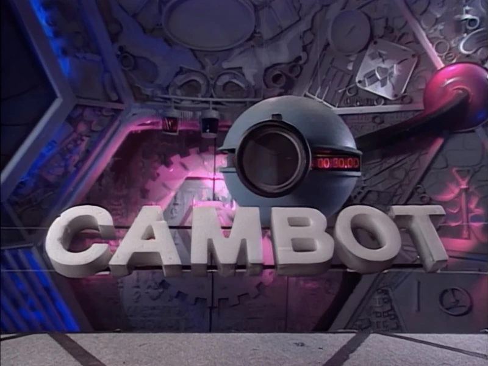

# Gizmonic Cambot

Open hardware and firmware for a cheap ESP32-S3 camera that records a rolling
buffer to its microSD card, indexes what happened with GPT and JEV on the
device, and answers questions from a LAN registrar — for example "show me
between 12:00 and 12:30 where the machine picks up a pipette tip."

This repository holds the bring-up firmware, the printable PETG case kit, the
FIXR setup path and registrar, host test libraries, and the design documents.

| Document | Read it for |
|---|---|
| [White paper](docs/cambot-whitepaper.pdf) | What it is and how a question becomes an answer |
| [Mechanical spec](docs/cambot-astra-mechanical-spec.pdf) | Current PETG kit and W-Mount contract |
| [Firmware / software plan](docs/cambot-firmware-repo-plan.pdf) | Tree, API, indexer, registrar, remaining milestones |
| [PETG kit](hardware/cambot-minimum-petg-kit/README.md) | Plates, parts, PETG settings, hardware, assembly |
| [Setup guide](fixr/SETUP.md) | Installing a camera, written for a person or a coding agent |
| [FIXR](fixr/README.md) | Profiles, secrets env names, and the LAN registrar |

HTML copies of the paper, mechanical spec and software plan sit next to the
PDFs. Sources are in `docs/src`. `docs/build.sh` rebuilds them (needs pandoc
and Google Chrome).

`reference/from-lloyd-barbot/` holds the board files these documents and the
firmware were written from. The `cambot` CLI is not shipped yet; follow
`fixr/SETUP.md` and flash with ESP-IDF until milestone M2.

## Licenses

Software is intended as Apache-2.0, the case and mounts as CERN-OHL-P-2.0, and
the documentation as CC BY 4.0. Those licenses are proposed in the documents
and are not yet attached as top-level license files (the kit carries
`LICENSE.md`).
