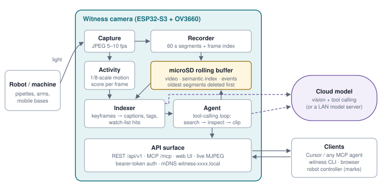
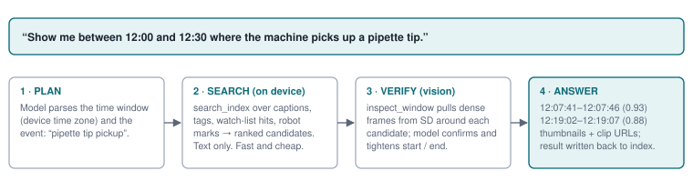
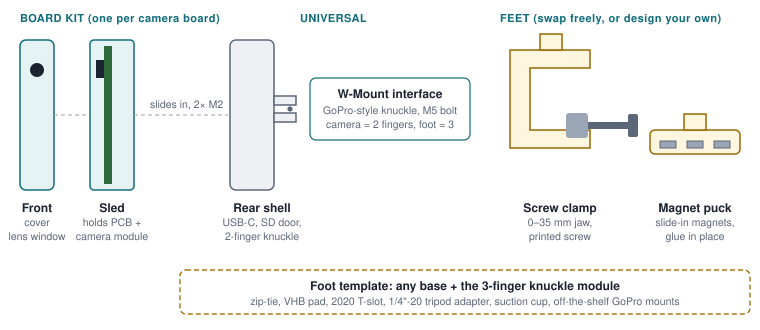

## Summary

Robots fail in ways their logs do not explain. A pipette misses a tip, a gripper
drops a part, a mobile base clips a table leg. Video of the event usually exists
only if someone happened to be recording, and even then no one wants to scrub
through hours of footage to find the four seconds that matter.

**Gizmonic Cambot** is an open-source camera built from a roughly $12 ESP32-S3 camera
board, a microSD card and a 3D-printed case. It records continuously into a
rolling buffer on the card, uses cloud vision models on the device to build a
searchable index of what happened, and answers questions in plain language from
a LAN registrar on a nearby computer:

> "Show me between 12:00 and 12:30 where the machine picks up a pipette tip."

The camera serves live frames, recordings, clips, its index and an MCP tool
surface over HTTP. A small registrar on the LAN shows the live view, keeps a
local copy of the index, and runs the ask loop so the camera stays free to
record. The same camera tools are available to a coding agent such as Cursor
through MCP.

The hardware, case, mounts, firmware and documentation are all open. The case
uses a GoPro-style **W-Mount** so the camera can hang from modular arms ending
in a dual-magnet foot, or any other W-Mount accessory.

## The problem

Labs and workshops are filling up with low-cost automation: liquid handlers,
desktop arms, 3D printer farms, pick-and-place cells, hobby mobile robots. Three
things make visual monitoring of them harder than it should be:

1. **Video is write-only.** Conventional cameras record well but cannot answer
   "when did X happen?" Finding an event means a human scrubbing a timeline.
2. **Cameras are closed or expensive.** Commercial "AI cameras" lock footage
   and models into a vendor cloud, cost $50–$300 each, and are designed for
   doorways rather than robot work cells.
3. **Mounting is an afterthought.** A camera that watches a robot needs to sit
   on the robot's frame, a shelf edge, an aluminum extrusion or a steel
   enclosure, often at an odd angle. Most cameras ship with one tripod thread.

## The concept

Cambot is designed to be cheap enough to leave on every machine:

- **Records everything locally.** About five VGA JPEGs per second by default
  (640×480, 200 ms pacing), stored as one-minute segments with a per-frame time
  index. When the card fills, the oldest hour of video is deleted first.
  Nothing leaves the camera unless indexing or a query sends it.
- **Indexes only what matters.** An on-board activity detector scores motion
  on every frame. Keyframes go to a vision model when something is happening,
  plus one idle keyframe a minute, so an empty room costs almost nothing.
- **Two index paths.** GPT captioning writes structured captions, objects and
  actions. JEV (TypeSafe) scores named **nouls**—yes/no watch questions with
  optional example images, bounding boxes and webhook alerts. Either path can
  run alone.
- **Answers questions off-camera.** The LAN registrar syncs index history into
  SQLite and asks gpt-4.1-mini against that copy, so a long question does not
  stall recording. The camera still exposes MCP tools for agents that want to
  search and inspect frames themselves.
- **Speaks to agents.** REST `/api/v1/...` and MCP `/mcp` share the same
  capabilities: status, recordings, index search, clips and live frames.

## How it works

### Capture and the rolling buffer

The OV3660 sensor produces JPEG frames directly, so the ESP32-S3 never encodes
video. The recorder appends frames to a one-minute segment file and writes a
small index of each frame's timestamp, offset, length and motion score.
Timestamps come from network time (SNTP) and are stored in UTC. Default
capture is **VGA at ~5 fps**. A **High performance** flag on the card (and in
the registrar UI) keeps that rate while flushing the card less often and
refreshing the live preview every 0.5 s.

| Mode | Resolution | Rate | Notes |
|---|---|---|---|
| Default | 640×480 (VGA) | ~5 fps | Chosen so TypeSafe image sides stay ≥ 280 px |
| High performance | 640×480 | ~5 fps | Faster preview; lighter SD flush |

Higher resolutions and rate tables from the original design brief remain
aspirational. Busy, detailed scenes produce larger JPEGs and fill the card
faster.

### The semantic index

Each keyframe the on-device indexer selects can be sent to:

- **GPT** (`gpt-4.1-mini` today) with a short scene profile, returning caption,
  objects, actions and robot state.
- **JEV** with the camera's noul list. Each noul is a yes/no question; optional
  example JPEGs, a box question and an HTTPS alert webhook travel with it.

Records land under `/sdcard/cambot/index/` as hourly JSONL. Consecutive
keyframes that share an action merge into **events**. Nouls live in
`nouls.json` (plus example JPEGs under `nouls/<name>/`). GPT and JEV indexing
are separate switches (`/api/v1/indexing`, `/api/v1/jev`).

**Robot marks** (`POST /api/v1/marks`) remain planned. Controllers will be able
to stamp the timeline with labels such as `step 12: pick tip` so the camera can
answer those queries exactly.

### Answering a question

Today the ask path runs on the **registrar**:

1. **Sync.** The registrar pulls recent index lines from the camera (including
   JEV watch scores) into a local SQLite history so questions can cover days
   without hammering the ESP32.
2. **Search.** gpt-4.1-mini reads that history for the time range in the
   question.
3. **Inspect (optional).** Agents using MCP on the camera can still call
   `inspect_window` / `make_clip` to pull frames or an MJPEG clip from the
   card when the text index is not enough.
4. **Answer.** The registrar returns moments with the supporting index text.
   Clip URLs point at the camera.

An on-board `/ask` agent that owns the full tool-calling loop on the ESP32 is
still on the roadmap. Until then, MCP on the camera and ask on the registrar
cover the same jobs for people and for coding agents.

### Interfaces

| Interface | Used by | What it offers today |
|---|---|---|
| Registrar at `http://<host>:8765/` | People | Live view, caption/noul UI, GPT/JEV/high-perf switches, ask box, index history |
| REST `/api/v1/...` | Scripts, registrar | Status, frame, recordings, clip.mjpg, index/latest, indexing, jev, nouls, perf |
| MCP `/mcp` | Cursor and other agents | `get_status`, `list_recordings`, `search_index`, `read_index_page`, `inspect_window`, `make_clip`, `get_live_frame` |
| `cambot` CLI | Setup and bulk work | **Not shipped yet** (milestone M2). Use ESP-IDF + `fixr/SETUP.md` |

## Example uses

- **Lab automation.** "List every tip pickup this morning that took more than
  one attempt." "Did anyone open the enclosure during the 2 PM run?"
- **Robot development.** Mount the camera over a work cell and ask what the
  robot did during a run, without scrubbing through raw video by hand.
- **3D printer farms.** Nouls for "spaghetti", "part detached" and
  "nozzle blob" turn the index into an alert feed via webhook.
- **Pick-and-place and QA cells.** Count picks per hour, pull clips of
  dropped parts, and (once marks land) compare robot claims to what was seen.
- **Agent-driven debugging.** A coding agent fixing robot firmware can ask the
  registrar what the camera saw after the last flash.

## Hardware

The reference board is the **FORIOT ESP32-S3-CAM** (Amazon B0GD2BZ9B1), a common
layout also sold by Freenove, Goouuu and Keyestudio:

| Item | Specification |
|---|---|
| Module | ESP32-S3-WROOM-1 N16R8: dual-core 240 MHz, 16 MB flash, 8 MB octal PSRAM |
| Camera | OV3660, 3 MP, on a 24-pin DVP flex cable |
| Storage | microSD (push-push, rear), 1-bit SDMMC on GPIO 38/39/40 |
| Connectivity | 2.4 GHz Wi-Fi 802.11 b/g/n, Bluetooth LE 5 |
| USB | Two USB-C: TTL (CH340 UART, for flashing and logs) and native USB OTG |
| Indicators | Power LED, WS2812 RGB LED (GPIO 48), user LED (GPIO 2) |
| Size | 62.6 × 28.3 mm PCB (vendor figure) |
| Power | 5 V USB, plan for 0.5 A |

### Case and modular mounts

The printable kit that ships in this repository
(`hardware/cambot-minimum-petg-kit/`, release 2026-11-04) is a **minimum PETG
mount**, not the earlier sled / front-cover / clamp design:

- **housing_v3** — open drop-in body with two center posts and a W-Mount
  knuckle; no front cover.
- **retainer_v3_short** — snaps over the PCB to hold it on the posts.
- **Modular arms** — male/female rods (25 mm and 50 mm shafts) locked with a
  6-32 set screw.
- **dual_magnet_foot** — three-finger W-Mount base with two external
  rubber-coated magnets under the plate.

Print the three plate 3MFs, assemble with M5 pivots and M4 magnet fasteners,
and stick the foot to steel. Off-the-shelf GoPro mounts also mate with the
W-Mount. Details, PETG settings and hardware are in the kit README. The
mechanical specification tracks that kit as the current design.

### Cost

| Part | Approx. cost |
|---|---|
| ESP32-S3-CAM board with OV3660 (from a 3-pack at $34.99) | $11.70 |
| 32 GB high-endurance microSD | $6–9 |
| PETG for housing, retainer, arms and foot | $1–2 |
| M5 bolts/nuts, 6-32 screw, M4 magnet hardware, 2 rubber-coated magnets | $5–10 |
| USB-C cable and 5 V supply (often already on hand) | $0–6 |
| **Total** | **about $25–40** |

Cloud cost depends on activity, not on recording time. Each captioned keyframe
or JEV call costs roughly as much as one small image prompt. The firmware
enforces a daily frame budget; recording continues when indexing pauses.

## Privacy and security

- Video stays on the SD card. Images go only to the model endpoints the owner
  configures (OpenAI-compatible and/or TypeSafe), and only when indexing or a
  query sends them. Captioning and JEV can each be switched off.
- The model endpoint can be any OpenAI-compatible server, including a model
  running on the local network, so GPT images need not leave the building.
- The API requires a bearer token (the camera password). The camera makes
  outbound connections to Wi-Fi, SNTP, the registrar and the model hosts. It is
  meant for a trusted LAN, not for exposure to the internet.
- Today secrets are compiled into `firmware/main/secrets.h` for bring-up
  (copy from `secrets.h.example`: `CAMBOT_WIFI_*`, `CAMBOT_CAMERA_PASSWORD`,
  `CAMBOT_REGISTRAR_URL`, `CAMBOT_TZ`, optional `CAMBOT_MODEL_KEY` /
  `CAMBOT_JEV_KEY`). NVS-backed provisioning and encrypted builds are still
  planned.

## Limitations

- **2.4 GHz Wi-Fi only**, WPA2 or WPA3 Personal. No enterprise (802.1X) or
  captive-portal networks in version 1.
- **Frame rate.** ~5 fps suits robot motion at human speeds. Very fast events
  can fall between frames; robot marks are the planned fix.
- **Sparse indexing.** The index is only as good as its keyframes and nouls.
  MCP inspect/clip cover the gaps at extra cost.
- **No audio and no H.264.** The ESP32-S3 has no video encoder; clips are MJPEG.
- **Clock.** The board has no battery-backed clock. Until network time is
  synced after boot, segments are marked unsynced.
- **Ask lives on the registrar** for now, not as `POST /api/v1/ask` on the
  camera. The `cambot` CLI, SoftAP provisioning, on-camera web UI and OTA are
  not shipped yet.
- **Model accuracy.** Captions and noul scores can be wrong. Every answer links
  to the footage so a person can check it.

## Open source plan and roadmap

| Item | License (proposed) |
|---|---|
| Firmware, host libraries, registrar | Apache-2.0 |
| Case, mounts, CAD source and STL | CERN-OHL-P-2.0 |
| Documentation | CC BY 4.0 |

| Milestone | Status |
|---|---|
| **M0–M1** Board bring-up, SD rolling buffer, REST, live frame, clips, eviction | **Done** in `firmware/` |
| **M2** Wi-Fi provisioning, `cambot` CLI, browser flasher | Not started; `fixr/SETUP.md` + secrets.h is the path today |
| **M3** Activity, on-device GPT + JEV index, nouls, registrar live UI | **Done** |
| **M4a** MCP on camera; registrar ask + index history | **Done** |
| **M4b** On-board `/ask` agent, marks, full index search API | Planned |
| **M5** OTA with rollback, encrypted builds, second board kit | Planned |
| **Later** Embeddings, multi-camera hub, clamp foot, front cover | Planned |

Companion documents: the **mechanical specification** (current PETG kit), the
**firmware repository plan** (tree, API and remaining work), and the **setup
guide** in `fixr/SETUP.md`, written so a person or a coding agent can follow it.
